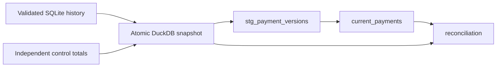
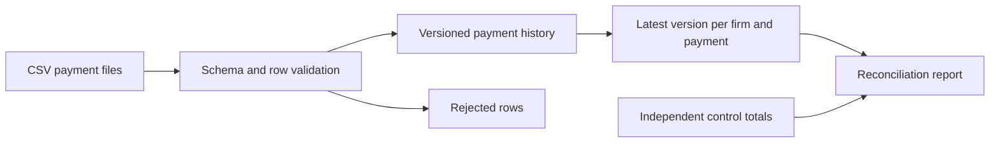

# LedgerCheck
A small, runnable financial-data reconciliation project built with Python and SQLite.

**Status:** local learning prototype with Python ingestion and dbt reporting on DuckDB. No cloud deployment or production-use claim.

All sample records are synthetic. No employer data or candidate documents belong in this repository.

## Business problem
Two firms deliver payment records. Files may contain duplicate payments, invalid amounts, and corrections that arrive out of order. Finance needs consistent totals and visible discrepancies against independently supplied control totals.

## Run locally
Requires Python 3.11+; no third-party dependencies.

From this folder:
```powershell
python -m unittest discover -s tests -v
python pipeline.py ingest data/payments.csv
python pipeline.py reconcile data/expected.json
python pipeline.py ingest data/corrections.csv
python pipeline.py reconcile data/expected.json
python pipeline.py ingest data/corrections.csv
```

The first ingestion intentionally returns exit code 2 because it quarantines a bad row. The first reconciliation also returns 2 because the totals differ. These are expected data-quality signals, not crashes. Successful commands return 0; invalid input or a conflicting version returns 1.

Database files default to run/ledger.db (ignored by Git). To repeat the demonstration from scratch without deleting anything, provide a fresh database filename **before** the subcommand on every command:
```powershell
python pipeline.py --db run/demo2.db ingest data/payments.csv
```

## Verified demo result
| Step | Observed result |
|---|---|
| Initial load | 3 accepted versions, 1 invalid row quarantined, 1 duplicate skipped |
| First reconciliation | firm-a is short 500 cents; firm-b is short 4,000 cents |
| Corrections | 2 versions accepted |
| Final reconciliation | firm-a: 13,000 cents; firm-b: 11,000 cents; both matched |
| Repeat corrections | already_loaded; no new records |

## dbt reporting layer
Python validates incoming files and records accepted history in SQLite. `warehouse.py` copies that history and independent control totals into DuckDB in a single transaction. dbt then builds three SQL views:



`stg_payment_versions` preserves accepted history. `current_payments` uses a window function to select the latest version per firm/payment. `reconciliation` uses a full outer join to retain firms missing from either side. Its statuses are `matched`, `mismatch`, `unmapped` (no control), and `missing_payments` (no accepted payments). Unlike the original Python report, dbt explicitly flags an absent firm even when its expected total is zero.

Install the optional analytics dependencies in a virtual environment (PowerShell, from this repository):
```powershell
python -m venv .venv
.venv/Scripts/python.exe -m pip install -r requirements-dbt.txt
.venv/Scripts/python.exe tests/verify_dbt.py
```

The integration check creates temporary databases, runs four real `dbt build` commands, and removes its temporary files afterward. The first and fourth builds intentionally fail **only** the reconciliation data test: the first detects the initial discrepancies; the fourth verifies missing firms and controls. The two corrected builds must pass. The script exits successfully only when all expected outcomes are confirmed. Existing ingestion tests still run separately with `python -m unittest discover -s tests -v`.

To build persistent reporting views from the SQLite demo database after following the original ingestion commands:
```powershell
.venv/Scripts/python.exe warehouse.py --source run/ledger.db --destination run/warehouse.duckdb --controls data/expected.json
$env:LEDGERCHECK_WAREHOUSE = Join-Path (Get-Location) 'run/warehouse.duckdb'
$env:DBT_SEND_ANONYMOUS_USAGE_STATS = 'false'
.venv/Scripts/dbt.exe build --project-dir dbt --profiles-dir dbt
```
On macOS/Linux use `.venv/bin/python` and `.venv/bin/dbt`, and set the warehouse with `export LEDGERCHECK_WAREHOUSE="$PWD/run/warehouse.duckdb"`.

After each new ingestion, rerun the snapshot command before dbt. This is a full snapshot for small local datasets, not incremental replication. It does not copy rejection/audit tables, track snapshot freshness, or provide production orchestration. Keep the SQLite ledger for those original records. Controls must use integer cents within the signed 64-bit range; DuckDB aggregates payments using 128-bit integers. Concurrent writers to the warehouse are outside this prototype's scope.

The dbt suite checks required values, payment-version integrity, current-payment grain, unique reporting firms, and reconciliation exceptions. The end-to-end check also compares corrected dbt results against Python and exercises old arrivals, repeated files, and invalid controls.

## How it works


- **Grain:** one version of a payment within a firm. Identical payment IDs in different firms are distinct.
- **Amounts:** non-negative integer cents in one assumed currency. No floating-point arithmetic.
- **Idempotency:** a file digest prevents exact reprocessing; the business key prevents duplicate versions across different files.
- **Corrections:** higher source versions supersede older versions. Older arrivals remain in history without replacing current values.
- **Conflicts:** two different amounts for the same business key/version abort the whole batch. History, rejects and receipt all roll back.
- **Quarantine:** invalid rows are recorded with line number and reason. Good rows in the same file are committed. Repair and submit a changed file; never silently edit history.
- **Controls:** expected.json is an independent source-control fixture, not calculated from the ingested output. Missing firms and unexpected firms are surfaced.
- **SQL:** current_payments is a view selecting each payment's highest source version.
- **Audit:** batches records digest, filename, counts and load time. Counts measure accepted versions, not current payment totals.

## Operational exercise
1. Explain why the first totals fail before opening corrections.csv.
2. Inspect the CSV and identify the duplicate and invalid row.
3. Predict how the correction changes each firm's total.
4. Run the corrections and repeat them.
5. Read test_conflict_rolls_back_entire_batch and explain why partial writes would be dangerous.
6. Add a test for a new failure case before changing implementation.

Start by reading data/payments.csv, then validate(), ingest(), reconcile(), and the tests. Be prepared to explain every design choice rather than memorizing a project description.

## Limits and design tradeoffs
This is a batch prototype with small in-memory file reads. It assumes the source supplies trustworthy monotonically increasing versions and all controls refer to the same reporting scope. It does not model currencies, deletions, negative refunds, invoice allocation, accounting periods or a general ledger. Matching totals alone does not prove individual records are correct.

Firm IDs prevent key collisions; they are **not access control**. There is no tenant security, secret management, scheduling, alert delivery or freshness monitoring yet. Quarantined records remain as historical evidence even after a correction. An exact rerun returns already_loaded; operators must inspect original batch/reject records for unresolved issues.

SQLite is used to make the behavior reproducible without cloud costs. Cloud access, costs and publishing should be agreed before deployment.

## Roadmap
1. Add invoice/payment allocation and record-level reconciliation with explicit reporting periods.
2. Extend the implemented dbt layer with invoice/payment relationships and reporting-period tests.
3. Add an API source with checkpoints, retry handling and simulated rate limits.
4. Add scheduled runs, freshness checks and failure notifications.
5. Deploy to one selected cloud/warehouse; document IAM, secrets, costs, performance and teardown.
6. Add a concise architecture walkthrough and measured results.

The project demonstrates Python validation, SQL and dbt modeling, transactions, testing, backfills and troubleshooting. It does not establish professional production tenure in dbt or cloud platforms.

## Repository
https://github.com/danielsegun97/ledgercheck
